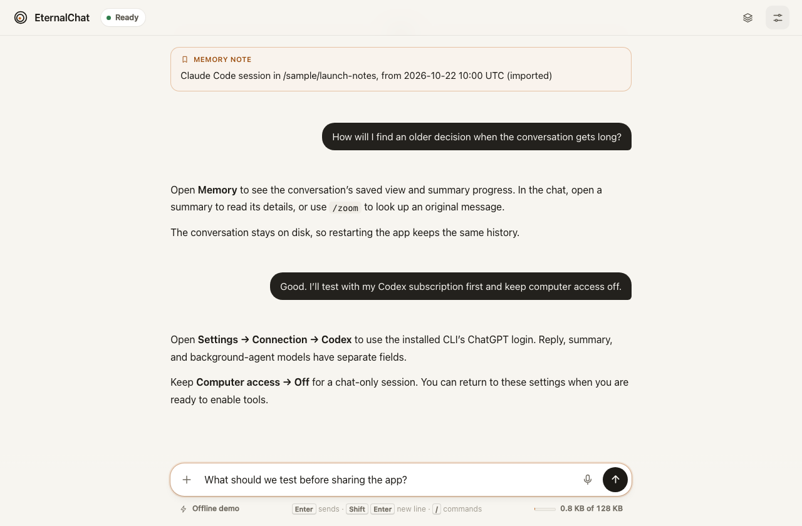
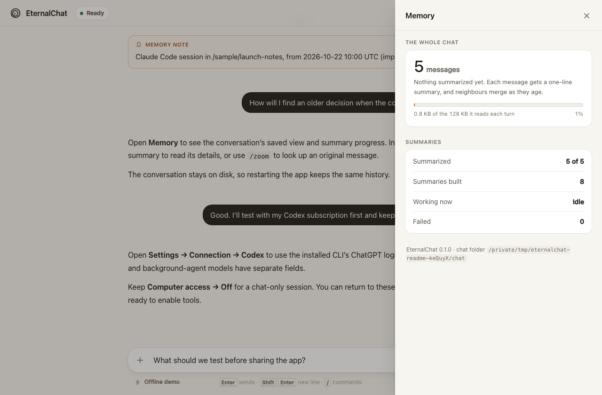
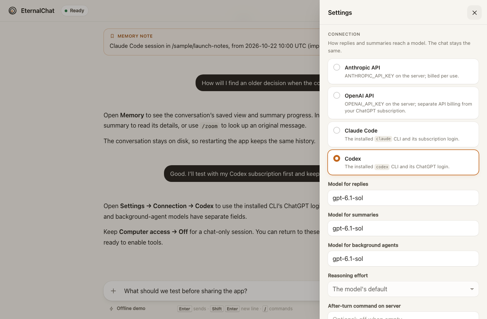
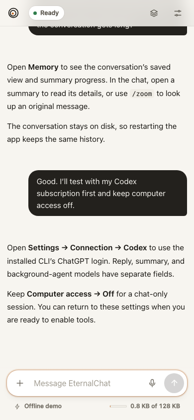

# EternalChat

A local terminal chat whose conversation is its memory. Append-only message logs
feed a background binary tree of summaries. Every fresh turn receives a saved,
size-budgeted view; `zoom` retrieves details down to the original message.

Implements the [UniiChat design](https://gist.github.com/VictorTaelin/91837951a5ce5b38f341ec1ba1df6449),
revision `3c190e06f34aba0c69f49042c526093269604935` (2026-10-08).
[OptMem](https://github.com/VictorTaelin/OptMem) is the related memory-tool example.

## A walk through the web UI

Start the server, open its private link, and keep one conversation across restarts.
These are captures of the running app with an illustrative imported conversation
in offline demo mode; the sample replies are not live model output.



1. **Chat.** Send a message, attach an image, or open an agent's tab. The same
   saved conversation is available in the terminal and browser.
2. **Inspect memory.** Open the layers icon to see the saved view, summary
   progress, and usage. Open summaries in the chat to read older details.
3. **Choose the connection.** Settings selects Codex, Claude Code, or an API,
   with separate reply, summary, and agent models. Computer access can stay Off.

<details>
<summary>See memory, Codex settings, and the phone layout</summary>

**Memory:** the conversation's saved view and summary progress.



**Codex settings:** subscription connection and model fields. Connection controls
are disabled in offline demo mode.



**Phone:** the same chat in a narrow browser window.



</details>

## Run

Requires **Python 3.11+ on macOS or Linux**, with no Python package dependencies.
Web search also needs `curl` on the server (included with macOS and in the
container; on Debian/Ubuntu: `sudo apt-get install curl`).
Install once from this checkout, so `eternalchat` works in any terminal:

```sh
python3 -m venv .venv
.venv/bin/python -m pip install -e .
ln -s "$PWD/.venv/bin/eternalchat" ~/.local/bin/eternalchat   # any folder on your PATH
```

Then:

```sh
eternalchat setup     # once: connection, models and chat folder, saved for every run
eternalchat           # chat in the terminal; the first run starts setup by itself
eternalchat web       # or chat in your browser
```

`setup` asks how to reach the model (an API key, or a Claude Code or Codex
subscription), checks that the key or CLI is there, and saves your answers in
`~/.eternalchat/config.json` (`ETERNALCHAT_HOME` moves it). API keys are never
saved: keep `export ANTHROPIC_API_KEY=...` in your shell profile. Run `setup`
again to change anything; Enter keeps each current answer.

### In your browser

```sh
eternalchat web       # the same chat as a page in your browser
```

`eternalchat web` serves the chat on this computer only (`127.0.0.1:8765`;
`--port` changes it, `--no-browser` only prints the link) and opens it.

The log is the memory itself, as the model reads it. Old stretches appear as
summary slips, stacked by how many messages they hold. Click one and it opens
into its two halves, and those open further, down to the original words, with
a bar at the top that folds them again. Recent messages, and any not yet
summarized, show in full, with day markers between them. Each message has
Copy and **Memory**, which shows the one line the model keeps for it. The
model's look-ups (`zoom`, `date`) fold into one "Looked back" line that opens
to show what it read.

While it replies, the page streams its thinking (never saved; afterwards it
folds into "Thought for 8s"), then the reply as it is written. The send button
turns into Stop. Anything you type meanwhile joins the reply in progress.
Images can be attached with +, by paste, or by drag and drop. Voice input supports
recorded transcription and browser dictation where available.

Typing `/` lists the commands: `/note`, `/agent Name task`, `/zoom 12` (opens
the summaries that hold message 12 and shows it), `/date`, `/memory`,
`/settings`, `/stop`, `/compact`. Each agent you start gets a tab with its live
transcript, and its report arrives in the chat. **Memory** (the layers icon)
shows the whole chat as a band from oldest to newest, how much of the 128 KB
view it fills, summary progress, and this session's tokens, cache reads
included. **Settings** switches between the API, Claude Code and Codex, along
with the models and reasoning effort, and saves the choice. It also holds the
light, dark or system theme, reply notifications, and a QR code that opens the
chat on your phone.

Recorded audio is available from **Voice input** beside the message draft. Set
`OPENAI_API_KEY` on the server to enable OpenAI `gpt-transcribe`, independently
of your chat connection; transcription has separate API billing. Start recording,
then **Stop and transcribe**, or choose an audio file. Review and edit the draft
before sending. **Cancel recording** discards it; recording stops after two
minutes. Files are limited to 24 MB. The server removes its private temporary
recording after the request ends. HTTPS or localhost and microphone permission
are required for browser recording. Browser dictation remains available where
supported. See the [OpenAI file transcription guide](https://developers.openai.com/api/docs/guides/speech-to-text).


To use browsers and terminals simultaneously, leave `eternalchat web` running
and open its printed link in another terminal (quote the link):

```sh
eternalchat connect 'http://127.0.0.1:8765/#TOKEN'
```

`connect` uses the server's chat, history and streamed replies without opening a
local store or needing local model credentials. `/help` lists its controls,
including `/history`, `/zoom`, `/attach`, `/agent`, `/goal`, `/stop` and
`/settings`. `/settings {"model":"MODEL"}` changes the server's model for all
views when no work is running. `/quit`, EOF and Ctrl-C detach while server work
continues. A dropped connection reloads recent history without resending inputs;
if a submission loses its acknowledgement, check history before submitting it
again. The initial view shows the latest 200 records; `/history 0` opens older
records in pages of 200. HTTPS links through your proxy work too.

Standalone `eternalchat chat` still owns the chat directly: close it before
starting `web`. The server's link carries a secret from `~/.eternalchat/web-token`
(readable only by you): anyone with the link can use your chat, so keep it
private. Browsers exchange it for independent, revocable sessions. Settings →
Create pairing link pairs another device with a single-use, ten-minute link;
Settings → Forget this device revokes the current session. Rotate the server
bootstrap token and restart to invalidate all derived sessions. Requests must also name this server as
their host, so other websites open in your browser can neither read the chat
nor post to it.

**Phones, tablets and other computers at home:** serve it over HTTPS with
Tailscale and install it as an app. [docs/home-server.md](docs/home-server.md)
walks through it, including keeping it running as a LaunchAgent:

```sh
tailscale serve --bg 8765
eternalchat web --no-browser --allow-host HOST.TAILNET.ts.net
```

**Anywhere, without a computer left on:** run it on Fly.io. It stops when no
page is open and starts again on the next visit, and it works with an API key or
with your Codex or Claude Code subscription. [docs/fly.md](docs/fly.md) has the
three steps:

```sh
deploy/fly.sh up eternalchat-yourname ams    # create, build, deploy; prints your link
deploy/fly.sh login codex                    # or: login claude
deploy/fly.sh doctor                         # check every part
```

### Offline demo

Try it offline first, in a chat of its own; nothing is charged:

```sh
eternalchat --data-dir /tmp/eternalchat-demo --demo ask 'Remember amber-42.'
eternalchat --data-dir /tmp/eternalchat-demo --demo ask '/recall 0'
eternalchat --data-dir /tmp/eternalchat-demo status
```

Demo replies and summaries are deterministic placeholders, not an LLM. They
exercise persistence and tool use without establishing memory quality. Keep demo
and real conversations in separate data directories. Without installing,
`python3 -m eternalchat` runs the same program from this checkout.

`eternalchat -h` lists commands, options and examples; `eternalchat COMMAND -h`
explains one command. Options may go before or after the command. An option
overrides its environment variable (`ETERNALCHAT_CONNECTION`, `ETERNALCHAT_CLI`,
`ETERNALCHAT_MODEL`, `ETERNALCHAT_SUMMARY_MODEL`, `ETERNALCHAT_DIR`), which
overrides the saved setting. The chat lives in the saved folder, by default
`~/.eternalchat/chat`, from any working directory; `--data-dir` selects another
chat. A chat in `./.eternalchat`, the default of earlier versions, is still used
when found in the working folder and nothing else is chosen; `setup` offers to
keep it as the one chat folder.

One process writes to a chat at a time; `connect` shares the server's writer.
`view`, `zoom`, `date` and `status` open
it read-only: they never write, may run alongside each other, and fail rather
than create a folder that holds no chat. While a session is open, use `/status`,
`/view` and `/zoom` inside it.

## Connection options

The default is **API** (`--connection api --api-provider anthropic`), using
`ANTHROPIC_API_KEY`. To select OpenAI's Responses API explicitly:

```sh
export OPENAI_API_KEY='your-key'
eternalchat --connection api --api-provider openai --model gpt-6.1-sol
```

The OpenAI default reply model is `gpt-6.1-sol`; its summary model defaults to
the reply model. `--summary-model` selects another model on the same provider.
API credit is separate from Codex/ChatGPT or Claude Code subscriptions. A failed
request never switches vendor, changes model, or falls back to paid API access.
The adapter uses `store: false`, preserves native encrypted reasoning and
assistant phase between tool rounds, and sends text/image function results
through the [Responses API](https://developers.openai.com/api/docs/guides/function-calling).
Reasoning continuation stays in the current request loop and is not stored as
chat memory. Ordinary memory/zoom and local search work with either API.

`--agent-model ID` selects a separate model for ordinary and screen agents;
empty inherits the reply model. It uses the same connection and credentials.
`--reasoning-effort LEVEL` controls replies and agents, including per-agent
overrides where supported. OpenAI uses `--service-tier` (`default`, `flex`,
`priority`, `fast`, `ultrafast` or `auto`); Anthropic uses `--api-speed standard`
or `fast`. Faster tiers can cost more and support depends on the selected model
and account. Summaries use model-default effort/speed. Unsupported combinations
fail explicitly rather than retry with another billing path. The status event
reports the observed model and served tier/speed when the vendor supplies them.
See [OpenAI reasoning](https://developers.openai.com/api/docs/guides/reasoning)
and [Anthropic fast mode](https://platform.claude.com/docs/en/build-with-claude/fast-mode).

The second option is **Subscription**, using an installed CLI and its existing
account login:

```sh
# Sign in once with the client you want to use:
codex login
claude auth login

# Then choose it in EternalChat:
python3 -m eternalchat --connection subscription --cli codex chat
python3 -m eternalchat --connection subscription --cli claudecode chat
```

Use the official Codex CLI or Claude Code (`claude`). Grok Build is no longer
supported: measured with Grok Build 1.0.62, it reused nothing of EternalChat's
request from cache, not even of an identical one, so every call paid for the
whole view.
Your account must have access to the selected CLI. CLI usage consumes its account
allowance; EternalChat does not supply a subscription. It leaves login and token
refresh to the CLI and removes API-key environment variables from child calls.
Codex is forced to use ChatGPT login. Check Claude account configuration in
Claude Code; locally configured providers and billing remain CLI-controlled.
See [Claude Code headless mode](https://code.claude.com/docs/en/headless).

Set `ETERNALCHAT_CONNECTION=subscription` and `ETERNALCHAT_CLI=codex` (or
`claudecode`) to save your choice in your shell environment. API remains
the default when no connection is selected. `--demo` still runs offline.

Subscription mode uses the CLI's default model unless `--model ID` is supplied;
`--summary-model ID` optionally selects a different summary model. Otherwise
summaries use the reply model. `ETERNALCHAT_MODEL` and
`ETERNALCHAT_SUMMARY_MODEL` apply in either mode: clear API-specific values when
switching clients. `--cli-executable PATH` overrides executable discovery, and
`--cli-timeout SECONDS` changes the 300-second per-call timeout.
`--reasoning-effort LEVEL` selects a level supported by that client and model
(for example `medium` or `high`); `--show-thinking` displays the reasoning events
the client actually provides. Displaying them does not change the reasoning
effort, and they are never saved to chat history.

Replies, summaries, and explicitly requested EternalChat agents all use the
selected client. Each request starts a fresh CLI process in a temporary folder,
with EternalChat's saved view and conversation; the app executes `zoom` and `date`
calls and supplies their results on the next request. Requests default to one
at a time. `--cli-concurrency N` allows 1–8 simultaneous calls within your account
limits. Replies take priority, followed by summaries of original messages needed
for memory, agents, and merges of older summaries. A conversation reserves one
slot across its memory-tool loop; active calls finish normally. Memory needed
for a waiting reply also moves ahead of queued older merges while its context
fits the configured budget. No coding-tool
approval bypass is used.
CLI settings may still impose organization policies or run client integrations.

Subscription mode supports images with both clients. Use `ask --image`
(repeatable) or `/attach PATH` inside `chat`; PNG, JPEG, GIF and WebP files up to
5 MB each use the same durable storage as API mode. `zoom` returns the original
images to the selected client, including after restarting or switching
connections. Select a model that supports image input.

```sh
python3 -m eternalchat --connection subscription --cli codex \
  ask 'Describe this picture' --image 'photo with spaces.png'
```

The adapter sends actual images through each CLI's native input:
[Codex app-server image inputs](https://learn.chatgpt.com/docs/app-server)
and [Claude Code streaming image blocks](https://code.claude.com/docs/en/agent-sdk/streaming-vs-single-mode).
Numbered references preserve the images' positions in the conversation and tool
results. Temporary input files are removed when the call ends, fails, or is
cancelled; image data is never placed on the command line.

Replies stream while the model is generating them. The adapter decodes just the
reply text from its JSON contract; tool arguments are validated and executed only
after the final result succeeds. CLI reasoning events are available with
`--show-thinking`. Native token and cache counts feed `/status` and `--verbose`,
counted once per call; missing counters stay absent. Codex also reports its
subscription usage windows and reset timestamps in `/status`. Counters describe
the client's model requests, including its own instructions, and are not a bill.

`--max-tokens N` is enforced by API mode. Claude Code receives it through its
native [`CLAUDE_CODE_MAX_OUTPUT_TOKENS`](https://code.claude.com/docs/en/env-vars)
setting, which applies to most requests and respects the model's cap. Codex
uses a prompt budget because its current adapter interface does not expose an
equivalent per-request setting. Caching is the client's, with one exception:
Claude Code receives the request as text blocks split before each message block,
with a one-hour cache mark where API mode marks the view. Claude Code marks
later blocks for an hour, and the API rejects a five-minute mark before them.
Measured with Claude Code 2.1.304 on a 47 KB view, the next call with four more
lines read 20,896 tokens from cache and wrote 1,155; as one block it read 2,348
and wrote 19,715. Codex's cache reuse is not yet measured. Login, quota, model/configuration, protocol and timeout errors have
distinct messages. An interrupted stream saves the text received so far marked
as incomplete; reasoning is never saved. Failures surface without
silently switching to API billing. Completed history stays in the same data
folder when switching connections. CLI-native retry and extra-usage settings
remain controlled by the client/account; the adapter does not retry model calls.

```sh
python3 -m eternalchat --connection subscription --cli codex \
  --show-thinking --verbose --reasoning-effort medium chat
```

An optional live verification uses a temporary chat and your account allowance:

```sh
python3 scripts/subscription_smoke.py codex
python3 scripts/subscription_smoke.py claudecode
# Also verify image understanding and zoom retrieval after restarting:
python3 scripts/subscription_smoke.py codex --images --streaming
python3 scripts/subscription_smoke.py claudecode --images --streaming
```

## The computer

The model can work on the computer that runs EternalChat, as UniiChat's does:
it runs commands (`shell`), reads files (`read`) and writes or edits them
(`write`, `edit`), in every connection mode. Each caller works in its own
folder under `~/.eternalchat/work` (`--work` moves it): `main` for the chat, an
agent's name for an agent. Relative paths point there; any path works.

```sh
eternalchat --tools auto   # the default: the model runs commands as it works
eternalchat --tools off    # chat, memory and web search; computer tools disabled
```

The page shows each command and its output, every file read, and every change
as a diff; the terminal prints each call as it starts. Stop ends a running
command and everything it started. Settings → *Computer access* switches
it, and the choice is saved.

**Other computers.** Any computer with EternalChat installed can join the chat
as one more place the model works, as UniiChat's devices do:

```sh
eternalchat device 'https://mac-mini.tail1234.ts.net/#TOKEN' --name laptop
```

It needs no chat of its own: it receives the commands and file changes the
model sends it, runs them in its `--work` folder, answers each, and stays
joined until Ctrl-C. The model names it in the
tools' `device` field; leaving it out means the computer EternalChat runs on.
Settings lists the computers joined and gives this command, with the link, to
copy. A temporary disconnection preserves jobs for 60 seconds after the server
detects it; reconnecting the same device delivers results without rerunning
commands. Jobs expire after 10 minutes. Stop requests made while offline are
delivered on reconnect. Ctrl-C explicitly leaves and cancels local work.

The device keeps private enrollment credentials and execution receipts under
`--work/.eternalchat-devices/`; preserve that folder when restarting it. A second
computer cannot take an enrolled name using different credentials. One device
process may use a given server/name/work folder at a time. The server stores
only a hash of the enrollment secret in the chat's saved device registry.
These identities complement the full-access chat link; they do not restrict
what someone holding that link can do through other chat APIs.

If the device process crashes after a command might have started, it reports
uncertain side effects rather than executing that command again. A server
restart ends old waiters; devices retain unclaimed results locally as receipts
and report their location, then accept fresh jobs after rejoining. Inspect the
affected files/processes before deliberately retrying uncertain work. Local
journals are limited to 128 MB; acknowledged/orphaned receipts retain at most
1,024 entries and are eligible for cleanup after 20 minutes on restart.

**What this means for safety.** Commands run with your account's permissions,
and nothing asks first: like UniiChat, it is no sandbox. Anyone who has the
page's link can make the model run any command on this computer, so keep the
link private, prefer Tailscale's HTTPS address to plain HTTP on your network
(the page warns when commands are on and it isn't), and choose Off when you
only want to talk.

The working folders organize files; they do not restrict access to other paths.
The Codex subscription adapter disables Codex's own tools and configures its
subprocess as read-only, but EternalChat executes its own tools outside that
subprocess. This does **not** sandbox EternalChat's commands or screen actions.
Localhost binding, authenticated sessions, tool cancellation, and macOS permission
checks provide controls, not OS isolation. For isolation, run the server in a
separate VM or container and expose only the files it needs; a Mac joined with
`eternalchat device` still runs actions with that Mac user's permissions.

For chat without computer tools, use `--tools off` or Settings → Computer access →
Off. Also leave **After-turn command on server** empty: explicitly configured
after-turn commands run even when computer access is Off.

**Mac screen tasks.** Ask the chat to do a task on a Mac marked **Screen control**
in the computer list. Its `computer(device, task)` tool immediately starts a named
background worker, so you can keep chatting. That worker has only screen actions
and its own task/transcript: screenshots, mouse clicks and drags, scrolling,
typing, key combinations, waits and region zoom. It sees no main-chat memory,
shell, file, search or agent tools. Ordinary subagents do not receive screen tools.

One task reserves a screen for its whole run, including between model calls.
Devices advertising the same screen identity share that reservation. Its actions
stay bound to the selected connection; replacing a device with another of the
same name cannot redirect a pending click. The worker sends its report when it
finishes. `tell` steers it or continues it later, including after restarting the
server; accepted instructions and the role/device identity are saved. Continuing
fails explicitly if the intended device is unavailable or its identity changed.

Each action returns a JPEG of the main display, at most 1280×800 pixels, to the
worker's selected model. Screenshots are saved in its transcript: open its tab
and the action to see them. **Stop agent** in that tab, or `/stop Name` in chat
or the terminal, cancels it and releases its reservation. A cancelled wait or
hold releases the held key. `/stop` without a name stops the main reply.

On that Mac, enable **Screen Recording** and **Accessibility** for the app that
runs EternalChat (for example Terminal) under System Settings → Privacy &
Security, then restart that app. On newer macOS versions the recording category
is called **Screen & System Audio Recording**.

**Brave's recording toggle does not grant the server permission.** If you started
`python3 -m eternalchat … web` in Terminal or iTerm, enable that terminal app. If
you started it inside Codex or an IDE, enable the app hosting that process, as
listed by macOS. Enable screen recording, rather than audio-only access, and
Accessibility for clicks and typing. Stop the server, fully quit and reopen the
launching app, then run the server again and retry the screen task. For a remote
Mac, grant permissions on that Mac to the app running `eternalchat device`.
See [Apple's screen recording permission guide](https://support.apple.com/guide/mac-help/control-access-screen-system-audio-recording-mchld6aa7d23/mac).

Missing permission produces an error with these instructions.
Apple's Command Line Tools (`xcode-select --install`) are
needed once to compile the bundled Swift helper, cached under the work folder.
No additional Python packages are needed. A Linux server can control the screen
of a joined Mac; it cannot control its own screen. `--tools off` disables screen
control together with commands and file access.

## Device sessions and background push

Browsers get independent 90-day sessions. Settings lists paired devices and
lets you revoke one without disconnecting the others. Pairing links work once
and expire after ten minutes. Computer join commands now have separate,
computer-only credentials.

Optional Web Push delivers generic reply alerts when the page is closed, with
no chat text in notifications. It needs `eternalchat[push]`, a persistent VAPID key,
HTTPS and browser permission; page-only notifications remain a labelled fallback.
See [device and push setup](docs/mobile.md). Phones use the browser or installed
PWA, including iPhone/iPad Home Screen notifications. Native iOS, Xcode and Apple
app signing are outside the required scope.

## Web search

Ask a question that needs current information, or ask the chat or an ordinary
agent to search. The `search` tool works with the API, Codex and Claude Code,
including with computer access off. It requests Brave Search's public web page
from the server and returns up to ten organic results in page order, with titles,
URLs and search excerpts. The page shows the search and clickable sources;
results are saved in memory and agent transcripts like other tool output.
The model is instructed to cite those URLs and to distinguish snippets from
reading a full page.

Search sends its query to Brave. It requires no search API key and adds no
search API charge. Normal model requests still use the chosen API or subscription.
The public page can rate limit, require browser verification, or change format;
those failures are reported, with no alternate backend or paid fallback. Each
request has a 20-second deadline and a 2 MB response limit; Stop cancels it.
The adapter ignores curl configuration files and does not follow redirects or
load linked pages, images, scripts or cookies.

Check search without a model call: `python3 scripts/search_smoke.py`.

## Past chats

Bring the chats you had elsewhere into this memory: Claude Code's and Codex's
sessions on this computer, or the Claude and ChatGPT websites' exports.

```sh
eternalchat import-chats --since 2026-10-01 --dry-run   # what it would bring, and its cost
eternalchat import-chats --since 2026-10-01             # shows the same, asks, imports, summarizes
eternalchat import-chats ~/Downloads/chatgpt-export.zip  # a website's export (or its conversations.json)
```

Each session arrives as a note naming it ("Claude Code session in ~/app, from
…, (imported)"), then its messages with their own dates: your words as yours,
the other AI's replies as replies. Its tool calls and their results come only
with `--with-tools` (here, 28 times as many summary calls for a week), and its
thinking never does. Anything that looks like a key, token, password or private
key is replaced by `[redacted]` first, since the chat keeps what it is given for
good. Importing again brings only what is newer. In the page, Settings → *Past
chats* offers **Choose files** and **Choose folder** on the device running your
browser, including when EternalChat runs on a remote server. Pick JSONL session
logs, Claude/ChatGPT JSON exports or export ZIPs. **Find on server** still scans
the server's own logs. Uploads are limited to 16 MB per file, 64 MB/500 files
per selection, and 50,000 messages/64 MB after parsing. ZIPs are read without
extracting member paths; their conversations JSON is limited to 64 MB.

The preview lists sessions, message counts and estimated summary calls before
you import. Progress and Cancel remain available while records are added.
Cancellation keeps records already saved. Selecting the same files after
cancellation or restart safely resumes using durable record IDs; it does not
duplicate the records already written. Uncommitted previews expire after 30
minutes of inactivity and are cleared by a server restart. Recognizable secrets
are redacted before storage; this pattern-based filtering cannot identify every
possible credential.

**Download memory backup** in the same section downloads a consistent ZIP with
message/summary logs, saved memory state, images and agent transcripts/state.
It excludes locks and server credentials outside the chat folder. To restore,
extract it into an empty folder, then start EternalChat with that `--data-dir`.
Browser backups are limited to 128 MB of source files; for larger chats, stop
EternalChat and back up the chat folder directly.

Every message over 512 bytes costs a summary call on the chat's connection, and
**the next reply waits until all are summarized**: start with a recent `--since`,
and with a subscription consider `--cli-concurrency 4` while it runs.

## Goals

**After-turn command.** `--after-turn 'COMMAND'` (or the corresponding Settings
field) optionally runs a local command after each reply turn, including a turn
stopped by the user. Commands are serialized in `WORK/after-turn`, have a
30-second limit, inherit no model API credentials and receive no chat text.
They run even with computer tools Off because this is explicit server
configuration. Hook failures are shown separately and do not invalidate saved
replies; closing EternalChat cancels their processes. The default is off.

`/goal TEXT` (in the page or the terminal chat) sends TEXT and keeps the chat
working on it: after each reply, a short check without tools asks the model
whether the chat shows the goal fully met. If not, the message "The goal isn't
satisfied yet: keep working." starts another turn; once it is, the note "Goal
met." ends the work. After 30 such turns in a row the goal waits for your next
message instead of spending more of your account. `/halt` drops the goal (a
reply in progress goes on); the page shows the goal at the top, with Halt. The
goal is saved with the chat.

## Commands

| Command | Purpose |
| --- | --- |
| `chat` | Interactive chat; input stays responsive during model work |
| `connect 'URL#TOKEN'` | Share a running web server's chat from the terminal |
| `ask 'message'` | One turn, then finish compaction and exit |
| `ask 'describe this' --image picture.png` | Send text and an image |
| `note 'memory'` | Import a memory without asking for a reply |
| `import notes.txt` | Import UTF-8 text as lossless consecutive note records |
| `view` | Print the persisted summary view |
| `zoom 40 8` | Open summary `40+8` into its two children |
| `zoom 40 --page 1` | Read page 1 of original message 40 |
| `zoom Research --page 0` | Read a named subagent's separate transcript |
| `date 40` | Read a message's timestamp |
| `status` | JSON storage, compaction, view and process-local usage metrics |
| `compact` | Retry and finish outstanding summaries |

Inside `chat`: `/help`, `/status`, `/view`, `/zoom ID [N] [PAGE]`, `/date ID`,
`/note TEXT`, `/compact`, `/attach PATH`, `/agent NAME TASK`, `/stop [NAME]`, `/zoom NAME [PAGE]`,
and `/quit`. Quote paths containing spaces. `/attach` adds an image to your next
ordinary message. A wrong or unknown command prints its usage and sends nothing;
start a line with `//` to send text that begins with `/`. With `--demo`,
`/recall ID` exercises the actual model-tool-result loop.

Every input is logged the moment it arrives, and its first ID is the historical
cutoff of the view it is answered from. Input received while a turn waits for
summaries joins that turn's first request. Input received during a call is
delivered after its tool results. If the response ends without another tool boundary, or
the tool-round limit stops the turn, queued input starts a fresh turn using a view
ending before its ID. Output logged after that queued input is available to
subsequent views, outside this earlier historical cutoff.

Subagents start when you ask for them: with `/agent Name task`, or in words
("send two agents to compare X and Y"), when the model starts them with its
`spawn` tool, naming each (FireAnt) and choosing its effort where the connection
allows. Each works alone in the background with the chat's memory and the
computer's tools, in its own working folder; at most eight work at once. The
model's `tell` sends one a message: a working agent reads it between its tool
calls, and a finished one goes on from its transcript, its reply arriving as a
`[Name]` message. Inside its own job, an agent first waits until every message
before its request is summarized, so the parent never stalls and the agent never
works from a stale view. Its steps stay in separate transcripts; its report enters
the main chat automatically, once, even after a crash.
Names are permanent and start with a letter, so a numeric `zoom` target is always
a message (agents saved by 0.1.0 under other names stay readable). EOF and `/quit` finish submitted turns and compaction, then cancel
unfinished agent jobs. Ctrl-C keeps all logged input and completed output; a reply
cut off mid-stream is saved marked `[interrupted: this reply did not finish]`.
Interrupted jobs are never automatically rerun; completed but undelivered reports
recover when the next `chat` or `ask` session starts.

## Models and instructions

Defaults: `claude-sonnet-4-6` for turns, `claude-haiku-4-5-20251001` for summaries.

```sh
python3 -m eternalchat --model claude-sonnet-4-6 \
  --summary-model claude-haiku-4-5-20251001 \
  --instructions preferences.txt --verbose chat
```

Environment alternatives: `ETERNALCHAT_MODEL`, `ETERNALCHAT_SUMMARY_MODEL`.
Instructions load once at startup. The tools and system prompt stay constant;
changing instructions or models changes cached prefixes. Credentials remain in
the environment. `--show-thinking` displays thinking events if emitted, without
persisting them. This app does not request extended thinking or send `xhigh`.

The Anthropic Messages adapter streams text/tools and uses five-minute cache
marks on the static system prompt, last whole four-line view block, and request
end. Concurrent requests for an identical model/view prefix wait until the first
of them begins its response, then all proceed together; for 270 seconds after
any response with that prefix begins (a cache read restarts the provider's five
minutes, as a write does) the prefix counts as cached and calls go at once. No keep-alive calls are
sent. Redirects are refused, so the API key is only ever sent to the configured
endpoint. Errors report the HTTP status and API error type only, never bodies or
messages, which may echo request content. **Distinct models have distinct
caches**; select the same turn/summary model to permit sharing. Actual cache hit
rates and minimum cacheable lengths are provider-controlled; `--verbose` displays
returned usage; `status` totals it separately for turns, agents and summaries. References: [caching](https://platform.claude.com/docs/en/build-with-claude/prompt-caching),
[streaming](https://platform.claude.com/docs/en/build-with-claude/streaming).

## Storage and recovery

```text
~/.eternalchat/
  config.json           saved settings (eternalchat setup)
~/.eternalchat/chat/    the chat folder (--data-dir)
  main/YYYY-MM-DD.jsonl  {i, kind, text, size, date, ...optional metadata}
  tree/YYYY-MM-DD.jsonl  {l, i, text, size}
  view.json             chronological [l, i] pairs
  compaction-view.json  smaller summary-context partition
  view-state.json       pending-batch flags
  assets/<sha256>       original image bytes
  agents/<Name>/        state.json (status, task, report outbox) and main/ transcript
  .lock                 OS advisory lock
```

- Sizes are UTF-8 bytes. Node `(l,i)` covers `2**l` messages from `i * 2**l`.
  `zoom(40,8)` opens node `(3,5)`. Short sources, including kind labels, bypass
  the model; child texts are joined only if their combined size fits 512 bytes.
- Above 128,000 rendered bytes, the main view merges built siblings toward
  64,000, ordered by `(T - last_message) / child_size`, oldest first on ties.
  Missing parents leave a persisted pending batch. The smaller compaction view
  uses 16,000/32,000 bytes and is coarsened anew when the main view merges.
- Up to eight queued compactions run concurrently, seeing only built context
  up to their source boundary. Ready parent summaries run before more leaves,
  so bulk imports can shrink their context as they progress.
  Oversized summaries get five attempts and the
  shortest nonempty result is retained, even if over 512 bytes. Actual byte
  sizes govern merging. Empty or tool-using answers are never a summary: the
  same request is asked again, within the five attempts. If the model refuses,
  or never answers with a line, the node keeps its source (children on one
  line each) cut to 512 bytes, as UniiChat does, and reports
  `compaction_error`. Asked again it would fail alike, and every later turn
  would wait on that node.
- Fresh turns wait for all prior leaves; no placeholders enter model input.
  Provider failures surface explicitly. New input or `compact` retries failed
  summaries. A failed retry keeps the shortest line already written. View targets
  can be exceeded while compaction lags. A conservative 180,000-byte request text
  budget (`Config.request_bytes`) applies to turns and every summary attempt.
  Excessive requests fail visibly with the source saved; a summary retry that
  exceeds the budget keeps its shortest usable result. Split large requests
  instead of relying on silent truncation.
- Non-tool text is losslessly split into consecutive records of at most 30,000
  bytes. Tool output is clipped to head/tail, at most 30,000 **characters** with
  a marker. Original text retrieval uses 12,000-character pages. PNG/JPEG/GIF/WebP
  images up to 5 MB are separate durable assets, returned on page 0. Assets are
  written atomically under their SHA-256; a corrupt copy is replaced with the
  verified bytes when the same image is added again. Only regular files are read,
  without blocking. Attachment references are validated (digest, and a media
  type matching the bytes) before any record mentions them.
- Appends are flushed and fsynced; nodes precede references to them. Views use
  atomic replacement plus directory fsync. Merge intent precedes partition
  updates, and pending flags are cleared only after both partitions are saved. A
  view save that fails is reported (`status` shows `view_saved` and
  `view_save_error`) and retried by the next update, `compact` or input; the node
  built before it still counts, so its parent proceeds.
  Uncertain log writes, including ones interrupted by Ctrl-C, disable further
  writes until reopening, so no message ID is ever handed out twice.
- Startup validates IDs, field types, sizes, child references and assets, then
  indexes file offsets and sizes; view byte budgets are computed from the index
  without reading files. Live summary work uses readiness queues, never repeated
  full-tree scans. Indices grow with history; original message content remains
  on disk.

Restart loads the saved view exactly, appending only built suffix leaves whose
checkpoint was interrupted. It reuses existing nodes and queues missing work.
Agent-report event IDs make interrupted chunk delivery idempotent.

Back up the **entire data directory while the chat is closed**, including views,
state, assets and agent transcripts. Torn/malformed records, missing snapshots,
children or assets fail visibly: restore a verified complete backup. The app does
not silently truncate logs or refit a lost view. A leftover `.lock` filename is
harmless; the OS releases its lock when the process exits. Writers lock both
`.lock` and the folder itself, so readers exclude them even in a restored copy
that lacks `.lock`.

Summaries are lossy and can omit retrieval clues: durable originals alone do not
guarantee perfect recall.

## Development

```sh
python3 -m unittest discover -v
python3 scripts/smoke.py
```

Opt-in real subscription checks consume the selected account's allowance:

```sh
python3 scripts/subscription_smoke.py codex --images --streaming
python3 scripts/subscription_acceptance.py codex --output /tmp/codex-acceptance.json
```

Use `claudecode` for the other client. The extended check uses disposable data
and working folders for files, search, agents, goal continuation, authenticated
loopback devices and a screenshot-only screen task. Its JSON records versions,
reported model IDs, timing, native token/cache counts and quota windows; unavailable
permissions or account quota stay explicit. It does not estimate money paid.
`--phase` selects individual checks and `--max-calls` bounds model requests.

Tests use scripted models and a local HTTP/SSE server, with no paid API calls.
`tests/test_architecture.py` enforces the dependency rule described in
[the architecture notes](docs/architecture.md).
They cover crashes, locking, images, Unicode, 20,001-prefix rollback equivalence,
long-history budgets/queues, streaming failures, tool ordering with live input,
fresh turns, agent-report recovery, read-only inspection, CLI usage errors and
cross-process CLI persistence. The HTTP
test needs permission to bind to `127.0.0.1`. Smoke prints structured phase evidence.
Live model quality, cost and cache hit rates are not established by these tests.

The web page is one file, `eternalchat/web.html`: plain HTML, CSS and
JavaScript, with no build step and no outside requests. Its install files
(manifest, service worker, icons) are in `eternalchat/static/`, and
`python3 scripts/make_icons.py` redraws the icons from one geometry.

See [design decisions and source coverage](docs/design.md). Work is tracked in
`.beads/`; `br list --all`, `br dep cycles`, and `br sync --flush-only` inspect/export it.
